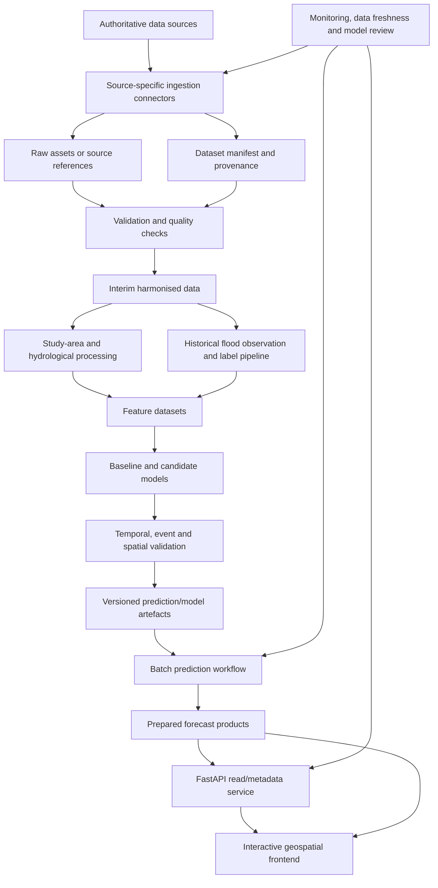

# NigeriaFloodWatch — Technical Architecture

**Document:** Technical architecture  
**Version:** 1.0 (Phase 1 baseline)  
**Status:** Proposed architecture; implementation choices subject to Phase 1 evidence and repository audit  
**Last updated:** 11 November 2026  
**Pilot:** Lokoja, Kogi State, Nigeria

---

## 1. Architecture purpose

This document translates the NigeriaFloodWatch project specification into a practical technical architecture. It describes how source data will be acquired, catalogued, validated, transformed, labelled, modelled, evaluated, served and visualised.

The architecture deliberately separates:

1. Earth observation and historical flood mapping.
2. Hydrometeorological forecast generation/evaluation.
3. Static flood-susceptibility and terrain analysis.
4. Exposure/risk communication.
5. Lightweight prediction serving.

These are related but different analytical products. They must not be collapsed into one opaque model or one undifferentiated map layer.

The architecture is designed for a single-person research project with constrained mobile-data use and cost sensitivity. It favours managed geospatial processing, small verified exports, open formats and a modular Python codebase. It does not introduce a workflow orchestrator, data warehouse or expensive continuously running compute service before there is a demonstrated need.

## 2. Core architecture decisions

| ID | Decision | Rationale / status |
|---|---|---|
| ADR-01 | GitHub remains the versioned source of truth for code, documentation, configuration and small test fixtures. | Keeps research and application code reproducible; large raw data are not Git assets. |
| ADR-02 | GitHub Codespaces is the primary cloud IDE for repository-level Python development. | Provides a full development environment tied to the repository. Use the included personal-account quota carefully and stop unused instances. |
| ADR-03 | Google Colab is the interactive research/notebook environment. | Useful for exploratory analysis and Earth Engine Python workflows; runtimes are temporary and must not be treated as persistent services. |
| ADR-04 | Google Earth Engine performs supported satellite and geospatial processing server-side. | Avoids unnecessary downloading of large image collections into Colab or the local machine. |
| ADR-05 | Phase 1 starts with manifests and file-based storage, not a database/data warehouse. | The immediate problem is data provenance and reproducibility, not concurrent multi-user querying. |
| ADR-06 | Google Drive is a convenience workspace only; it is not the canonical data catalogue. | Drive may hold small temporary notebook exports, while repository manifests document authoritative data locations and provenance. |
| ADR-07 | Google Cloud Storage is a future object-store option, introduced after a cost/region/egress assessment. | Avoids premature recurring storage and transfer costs. |
| ADR-08 | The forecasting service will not perform heavy raster acquisition or model training inside HTTP request handlers. | Serving must remain lightweight, testable and predictable. |
| ADR-09 | The first scientific workflow is staged: hydrological forecast assessment at catchment/reach scale and local inundation observation/label construction. | Prevents unsupported high-resolution local forecasts from coarse forecast inputs. |
| ADR-10 | Prediction grid, spatial unit, lead intervals and model family remain evidence-gated. | Native data support and label quality determine these choices. |

## 3. Logical architecture



## 4. Data-source layer

### 4.1 Source families and acquisition paths

| Source family | Candidate source | Preferred acquisition route | Processing role |
|---|---|---|---|
| SAR imagery | Sentinel-1 GRD | Google Earth Engine `COPERNICUS/S1_GRD` collection | Event observation, water/inundation mapping and label support |
| Historical rainfall | CHIRPS v3 | CHC-hosted programmatic files or a verified Earth Engine collection if available | Antecedent rainfall and long-term context |
| Forecast rainfall | CHIRPS-GEFS | CHC-hosted forecast files/API path documented by provider | Forecast-vintage rainfall predictors |
| Terrain | SRTM / NASADEM candidate | Earth Engine catalogue or authoritative NASA/USGS source | Elevation, slope and selected terrain derivatives |
| Hydrography | HydroSHEDS / HydroBASINS | Earth Engine data catalogue and original product documentation | Catchment topology and river-network context |
| Hydrological history | GloFAS historical/reanalysis | Copernicus Early Warning Data Store (EWDS), CDS API or supported client | Modelled historical discharge and hydrological state |
| Hydrological forecasts | GloFAS forecasts/reforecasts | EWDS / CDS API | Ensemble discharge forecasts, skill analysis and baseline comparison |
| Exposure | OpenStreetMap | Overpass API for bounded extracts or provider-approved extracts | Roads, buildings, settlement and infrastructure context |
| Event records | NIHSA, NIWA, NEMA, UNOSAT and documented research sources | Official portals, reports, data requests or published geospatial products | Event catalogue, validation and label evidence |

No source is considered production-ready until its dataset version, coverage, resolution, timestamp semantics, format, licence and reproducible access method have been checked. The `DATA_INVENTORY.md` and separate source/licence register remain the detailed records.

### 4.2 Sentinel-1 acquisition contract

For `COPERNICUS/S1_GRD`, the ingestion workflow should record and explicitly filter relevant metadata rather than blindly mosaicking all scenes. At minimum, inspect:

- Acquisition start/end time.
- `instrumentMode`.
- `transmitterReceiverPolarisation` (for example, VV and/or VH availability).
- `orbitProperties_pass` (ascending or descending).
- Relative orbit number where appropriate for repeat comparisons.
- `resolution_meters` and pixel spacing.
- Platform/satellite identifier and scene footprint.
- Incidence-angle band/range.
- Number of scenes and spatial coverage over each requested area.

Comparisons and composites should use consistent acquisition geometry where possible. Ascending and descending passes, polarisation combinations and instrument modes should not be mixed without a reasoned method. The collection's documented preprocessing does not remove the need for application-specific water masking, terrain/layover considerations, speckle handling, permanent-water masking and independent validation.

Earth Engine should perform collection filtering, per-scene inspection, compositing and bounded exports server-side. Export only the minimum representative sample needed for local verification during Phase 1.

### 4.3 Rainfall acquisition contract

Historical CHIRPS v3 and forecast CHIRPS-GEFS must be stored and processed as distinct products.

For every rainfall record/file, preserve:

- Product and version.
- Preliminary/final status where applicable.
- Forecast initialisation/issue time for forecast products.
- Valid time or accumulation period.
- Units and accumulation interval.
- Native grid and CRS.
- Download/retrieval time.
- Provider metadata and file checksum where feasible.

CHIRPS-GEFS forecast vintages must be retained or reproducibly referenced for historical backtesting. Realised historical rainfall must not be substituted for a forecast that would have been available at the historical issue time.

### 4.4 GloFAS acquisition contract

Keep historical/reanalysis, forecast and reforecast products in separate source tables and paths.

For each GloFAS retrieval, record:

- Dataset short name and portal URL.
- GloFAS model/product version.
- Product class: historical/reanalysis, forecast or reforecast.
- Variable, units and temporal aggregation.
- Forecast initialisation time, lead time and valid time where applicable.
- Ensemble member/statistic where applicable.
- Grid coordinates, river-cell/reach identifier if available, upstream-area and elevation auxiliary data used for interpretation.
- File format (for example GRIB2 or NetCDF-4).
- CDS/EWDS request definition and retrieval time.

GloFAS historical data are modelled hydrological estimates. They are not in-situ gauge observations. Forecast/reforecast datasets have different time semantics and must not be treated as interchangeable with historical simulations. Product version changes must be recorded; do not hardcode a version number in a generic connector.

### 4.5 Source-specific connector pattern

Each connector should expose a consistent small interface:

1. Validate request parameters (source, time range, area, product/version).
2. Query source metadata and record the selected assets.
3. Acquire or export data using bounded, reproducible requests.
4. Write a manifest before/with the data output.
5. Return a structured acquisition summary, including warnings and incomplete coverage.
6. Never silently replace a failed or missing product with a different product/version.

A connector should be independently testable using mocked metadata or very small fixtures. Credentials must be injected through environment variables, notebook secrets or a secrets manager—not committed in scripts or config files.

## 5. Storage and data organisation

### 5.1 Data zones

Use the existing `data/` concept with the following meanings:

- `data/raw/`: immutable source downloads or bounded source exports, where local storage is justified. Preserve source-native formats. Avoid committing large files to Git.
- `data/interim/`: temporary or partially processed, still traceable products.
- `data/processed/`: quality-checked, harmonised and analysis-ready outputs.
- `data/figures/`: lightweight diagnostic figures and QA maps suitable for version control where useful.

The directory names do not imply that all data must reside on the developer's laptop. Large or repeated source assets may remain in Earth Engine or an object store; the repository should contain manifests and scripts that identify them.

### 5.2 Preferred formats

| Data type | Preferred working format | Notes |
|---|---|---|
| Source satellite/raster files | Provider-native format, GeoTIFF where exported | Do not discard source metadata |
| Analysis-ready rasters | Cloud Optimized GeoTIFF (COG) where appropriate | Preserve CRS, transform, nodata, units and band descriptions |
| Multidimensional climate/hydrology | NetCDF-4 or Zarr when justified | Preserve coordinates, time, units and forecast dimensions |
| Vector geometries | GeoPackage for local GIS work; GeoParquet for scalable tabular analytics; GeoJSON for small interchange | Keep source identifiers and CRS metadata |
| Tabular time series/features | Parquet | Include explicit keys and time semantics |
| Small metadata/manifests | JSON, YAML or CSV | Human-readable and version-controlled |
| Original hydrological forecast files | GRIB2 or provider-native NetCDF | Do not flatten away ensemble and lead-time dimensions prematurely |

Do not introduce a database, STAC server, DVC or lakehouse during Phase 1 unless a concrete requirement emerges. Dataset manifests and checksums provide the initial provenance layer.

### 5.3 Dataset manifest

Every acquired or generated dataset should have a machine-readable manifest with, at minimum:

- `dataset_id` and descriptive name.
- Provider, source URL/catalogue ID and licence reference.
- Product, version and processing level.
- Acquisition method and source query parameters.
- Retrieval timestamp.
- Observation/acquisition time or forecast issue/valid-time range.
- Geographic footprint/AOI and CRS.
- Native spatial and temporal resolution.
- File format, units, bands/variables and nodata semantics.
- File path or remote asset identifier.
- File size and checksum where applicable.
- Processing script/version and key parameters for derived products.
- Quality-control status and known limitations.

A sample `dataset_manifest.yaml` schema can be added when Task 4 expands the inventory. The manifest must not contain passwords, tokens or private keys.

## 6. Study-area and geospatial processing layer

### 6.1 Separate geometry objects

Maintain separate versioned geometries for:

1. `lokoja_lga`: administrative reporting boundary.
2. `lokoja_floodplain`: evidence-derived local inundation/floodplain analysis area.
3. `niger_benue_upstream`: verified hydrological contributing area/network.

Use unique IDs, source attributes and documented geometry lineage. Do not overwrite the administrative polygon with a floodplain or catchment geometry.

### 6.2 CRS strategy

- Preserve source CRS and coordinates.
- Use EPSG:4326 for interoperable interchange and API coordinates where suitable.
- Use WGS 84 / UTM zone 32N (EPSG:32632) for local Lokoja distance/area operations where its zone is appropriate.
- Do not use one UTM zone blindly for the entire upstream Niger–Benue catchment, which extends much farther geographically. Use an appropriate equal-area projection or geodesic method for basin-wide area calculations.
- Every output must record its CRS, units and transformation method.

### 6.3 Resolution and resampling

Maintain native-resolution datasets for as long as possible. Any analytical grid must be justified by the prediction unit, label support, native source resolutions and decision use.

- Continuous variables: choose a resampling method suited to variable meaning and preserve the native-source resolution in metadata.
- Categorical classes: use nearest-neighbour or another explicitly justified categorical method.
- Extensive quantities/accumulations: use an aggregation/resampling method that does not create misleading totals.
- Coarse forecasts: aggregate or summarise to hydrological units when that is more defensible than upsampling.

A 0.05° rainfall grid, a GloFAS hydrological grid, a 30 m DEM and a Sentinel-1 GRD image do not share the same spatial support. Reprojecting them to a common CRS does not make their information content equivalent.

### 6.4 Temporal harmonisation

Use explicit timestamps and intervals:

- Satellite acquisition time.
- Rainfall observation accumulation start/end.
- Forecast issue/initialisation time.
- Forecast valid time/lead time.
- Discharge aggregation period.
- Flood event start/end/observation time.
- Prediction issue time and validity period.

Store internally in UTC and convert only for display. Daily totals must define the time-zone and accumulation convention. Never merge forecasts based only on calendar date if their issue/valid-time windows differ.

## 7. Quality assurance and validation layer

Each acquisition and processing step should emit a compact QA report.

### 7.1 Common checks

- File exists and can be opened/read.
- Expected geometry/bands/variables are present.
- CRS, affine transform, dimensions and resolution are recorded.
- Geometry validity and unexpected empty geometries are checked.
- Nodata, missing values and value ranges are summarised.
- Time coverage, duplicate timestamps and temporal gaps are checked.
- Spatial coverage intersects the intended AOI as expected.
- Units and variable names are consistent with source documentation.
- Source version and retrieval parameters are traceable.
- Warnings and failed checks are retained in the report.

### 7.2 Sentinel-1-specific checks

- Scene count and coverage by date/pass/orbit/polarisation.
- Consistent instrument mode and resolution.
- Acquisition geometry consistency for temporal comparisons.
- Valid backscatter ranges and nodata footprint.
- Permanent-water/urban/vegetation limitations documented.
- Sample export dimensions and pixel size verified.

### 7.3 Rainfall and discharge-specific checks

- Units and accumulation/averaging period verified.
- Forecast issue/valid times and lead times verified.
- Ensemble dimension/member count retained for forecast products.
- Spatial alignment of river pixels/catchment aggregates checked.
- Reanalysis and forecast products clearly separated.
- Missing days, unavailable cycles and product-version transitions reported.

### 7.4 Gate before marking data acquired

A source is not complete because an API request was written or a GEE export task was started. Acquisition is complete only when the sample output exists, can be read, its metadata is inspected, the AOI/time coverage is checked, and the QA report is saved.

## 8. Historical flood-event and label subsystem

This subsystem is a critical dependency for any supervised forecast model.

### 8.1 Event catalogue

Create a structured event table with fields such as:

- `event_id`.
- Event name/description where available.
- Event start/end interval, including uncertainty.
- Source and source document/product identifier.
- Source publication date and observation/acquisition date.
- Affected geometry/administrative locations.
- Event type (riverine, pluvial, mixed, unknown).
- Reported impacts where supported.
- Evidence quality/confidence.
- Independent corroboration links.

Do not force a precise date where the evidence only supports a date range.

### 8.2 Flood footprint evidence

Store each footprint/observation separately from the event record. Preserve:

- Observation time and sensor/product.
- Mapping method and algorithm version.
- Original spatial resolution and effective mapping scale.
- Inclusion/exclusion rules.
- Permanent-water masking and known false-positive/false-negative issues.
- Independent validation status.
- Confidence/quality class.

A Sentinel-1-derived water mask is an observation product with uncertainty. It is not automatically ground truth.

### 8.3 Label table

The training label table must link a spatial unit and valid period to an event/observation record. It must support `positive`, `negative` and `unknown`/unlabelled states. A missing satellite acquisition or report must not be coded as a negative event.

For forecast training, label times must be aligned to the forecast-valid window and the feature table must reproduce the data available at the corresponding historical issue time.

## 9. Feature engineering layer

Feature generation should be modular, documented and deterministic.

### 9.1 Feature families

**Dynamic hydrometeorological features**
- Forecast rainfall accumulations by lead interval.
- Antecedent observed rainfall accumulations (for example, rolling windows), ending no later than forecast issue time.
- Forecast discharge/ensemble summaries by reach or hydrological unit.
- Historical discharge context and anomalies, with the product/version and time semantics retained.
- Soil wetness/runoff variables when valid, available and useful.

**Static terrain and hydrographic features**
- Elevation and slope.
- Height above nearest drainage or other hydrologically meaningful terrain metrics, where methods/data support them.
- Distance/proximity to river and channel network.
- Catchment area, drainage context and verified network position.
- Other justified terrain/land-surface descriptors.

**Observed flood-state/context features**
- Latest flood state known by issue time, if available.
- Time since last relevant satellite observation.
- Observation coverage/quality indicators.

**Exposure/context features**
- Settlement/building/road summaries may be used for impact/risk communication.
- Exposure variables must not be mixed into a pure physical-hazard target without a scientific reason.

### 9.2 Feature lineage

Every feature column must have a definition, units, source, transformation, spatial support, time semantics, missing-data rule and leakage review. Feature tables should include stable spatial keys and issue/valid-time keys.

Avoid opaque feature engineering in notebook cells. Promote stable transformations into tested Python modules after exploration.

## 10. Modelling and evaluation layer

### 10.1 Staged scientific strategy

**Track A — Historical inundation observation and mapping**

- Build an event catalogue.
- Produce and QA Sentinel-1 sample observations.
- Compare mappings with official/event evidence where possible.
- Construct confidence-aware flood footprints and label records.

**Track B — Hydrological forecast assessment**

- Establish the verified Niger–Benue hydrological network and candidate discharge locations.
- Inspect GloFAS historical, forecast and reforecast products separately.
- Evaluate whether forecast vintages and event labels overlap sufficiently for backtesting.
- Establish simple hydrological/climatological baselines at reach/catchment scale.

**Track C — Local floodplain susceptibility/context**

- Derive and QA terrain and drainage descriptors.
- Characterise historical inundation locations.
- Keep susceptibility distinct from the time-specific forecast.

**Track D — Integrated 72-hour hazard forecast (conditional)**

- Only proceed when forecast inputs, historical issue-time reconstruction and labels are adequate.
- Begin with transparent statistical and tree-based baselines.
- Evaluate event-held-out, chronological and spatially blocked performance.
- Only translate catchment/reach hazard to local floodplain probabilities if supported by labels and a validated spatial/hydraulic method.

### 10.2 Model candidates

- Logistic Regression as an interpretable baseline.
- Random Forest and gradient-boosted trees for tabular nonlinear relationships.
- U-Net/segmentation models only for a sufficiently labelled imagery task.
- Temporal deep-learning methods only with adequate sequential data and independent events.

Do not use deep learning to compensate for missing flood labels or forecast archives.

### 10.3 Validation design

The evaluation module should support:

- Chronological splits.
- Flood-event-held-out splits.
- Spatially blocked splits where transfer is claimed.
- Lead-time-specific and event-specific results.
- Baseline comparisons.
- Class-imbalance-aware metrics.
- Calibration and uncertainty assessment.

Recommended metrics include precision, recall, F1, PR-AUC, ROC-AUC as secondary, Brier score, reliability/calibration, false-alarm ratio, probability of detection, critical success index and IoU for segmentation products.

No model is operationally releasable until data provenance, label quality, leakage checks, evaluation design, probability calibration and failure modes have been reviewed.

## 11. Prediction artefacts and serving layer

### 11.1 Batch-first inference

The forecast workflow should run as a scheduled or manually triggered batch process:

1. Check whether current forecast inputs are available and fresh.
2. Retrieve the required forecast cycle(s) and antecedent data.
3. Validate temporal and spatial coverage.
4. Generate the exact features expected by the registered model.
5. Run inference outside the public request path.
6. Apply calibration/threshold logic if validated.
7. Write a versioned prediction artefact and metadata.
8. Publish the prepared product for API/frontend consumption.

If required input coverage is incomplete or late, the run should fail closed: record the reason and mark no prediction available rather than manufacturing a probability.

### 11.2 Prediction artefact contents

Each batch output should include:

- `prediction_run_id`.
- `issued_at`, `valid_from`, `valid_to` and lead-time definition.
- Spatial unit ID or grid definition.
- Predicted probability/score and any validated class/threshold.
- Model name/version and calibration version.
- Input dataset IDs, versions and source forecast issue times.
- Input freshness/coverage flags.
- QA status and uncertainty/limitations.
- Processing code revision and run timestamp.

Suitable output formats may include GeoParquet for vector/tabular predictions and COG for raster probability surfaces, depending on the final spatial product.

### 11.3 FastAPI responsibilities

FastAPI should be a lightweight read/metadata/prediction-query service. It should not run large Earth Engine exports, download multi-gigabyte rasters, train a model or perform expensive spatial processing inside a normal HTTP request.

Potential future endpoints:

- `GET /health` — service health.
- `GET /metadata` — current model, data and forecast metadata.
- `GET /forecasts/latest` — latest valid prepared forecast metadata.
- `GET /forecasts/{run_id}` — a specific forecast run.
- `GET /forecasts/{run_id}/values` — query prepared values for a supported location/unit.
- `GET /observations` — observed flood products and their timestamps.

Exact endpoint schemas will be designed when the model output and spatial support are known. The API must distinguish observation layers, susceptibility, forecast hazard and exposure overlays.

## 12. Frontend and geospatial visualisation

The first frontend can use Leaflet for a relatively lightweight interactive map. Deck.gl can be considered later if large, dynamic vector/raster rendering justifies it.

The map should show separate layers for:

- Administrative boundary.
- Local floodplain analysis area.
- Upstream hydrological context where useful.
- Observed flood footprints with acquisition time/source.
- Static susceptibility/context layers.
- Forecast hazard products with issue time and validity window.
- Exposure features.

Legends and popups must explain data type, date/time, source, resolution, confidence and limitations. Forecasts must never be styled or labelled as observed inundation.

## 13. Development and runtime environments

### 13.1 GitHub Codespaces — primary cloud IDE

Use Codespaces for:

- Editing the Python package and configuration.
- Managing dependencies.
- Running tests and lightweight local processing.
- Developing API code when that phase begins.
- Reviewing project documentation and scripts.

Codespaces are development environments, not persistent data storage or production compute. Stop unused instances and monitor monthly compute/storage allowances.

### 13.2 Google Colab — research environment

Use Colab for:

- Exploratory notebooks.
- Earth Engine Python API experiments.
- Small geospatial sample analysis.
- Rainfall and terrain exploration.
- Model experiments when local/Codespaces resources are insufficient.

Colab runtime storage is temporary. Persist notebooks in GitHub/Drive and persist important outputs to a documented data location. Re-authenticate Earth Engine after runtime restart as required.

### 13.3 Google Earth Engine — geospatial processing

Use Earth Engine's server-side collection operations for supported satellite/raster processing and export bounded outputs. Keep scripts in `scripts/gee/` and record collection IDs, filters, scale, CRS, date windows and export parameters.

### 13.4 Storage progression

Phase 1:

- GitHub for code/docs/configuration and small test assets.
- Earth Engine assets and source portals for remotely hosted data.
- Drive or local workspace only for small temporary/exported research samples, with manifests.

Later, if needed:

- Google Cloud Storage for persistent, versioned or repeated large datasets and prepared prediction products.
- Object lifecycle rules and budget alerts before storing large historical rasters.

A paid cloud bucket is not a Phase 1 prerequisite.

## 14. Proposed repository architecture

The existing repository is a scaffold with some substantive GEE and data artefacts. The following package layout is the target direction, not an instruction to restructure everything immediately. First preserve and reconcile existing files; move or rename only when the repository audit and module boundaries justify it.

```text
NigeriaFloodWatch/
├── README.md
├── LICENSE
├── pyproject.toml
├── .gitignore
├── docs/
│   ├── PROJECT_SPEC.md
│   ├── ARCHITECTURE.md
│   ├── DATA_INVENTORY.md
│   ├── DATA_DICTIONARY.md
│   ├── MODEL_DESIGN.md
│   ├── METHODOLOGY.md
│   └── DATA_SOURCES_AND_LICENCES.md
├── configs/
│   ├── project.yaml
│   └── sources/
├── scripts/
│   └── gee/
│       ├── hydrobasins_exploration.js
│       ├── hydrobasins_network_analysis.js
│       ├── upstream_catchment_tracing.js
│       └── sentinel1_sample_acquisition.js
├── notebooks/
│   ├── 01_data_exploration.ipynb
│   ├── 02_sentinel1_analysis.ipynb
│   ├── 03_rainfall_analysis.ipynb
│   ├── 04_terrain_analysis.ipynb
│   └── 05_model_experiments.ipynb
├── src/
│   └── nigeria_floodwatch/
│       ├── __init__.py
│       ├── ingestion/
│       ├── preprocessing/
│       ├── geospatial/
│       ├── labels/
│       ├── features/
│       ├── models/
│       ├── evaluation/
│       ├── api/
│       └── utils/
├── tests/
├── data/
│   ├── raw/
│   ├── interim/
│   ├── processed/
│   └── figures/
├── models/
├── reports/
├── docker/
└── .github/
    └── workflows/
```

The exact folder names should follow the final repository audit. In particular, avoid retaining both `test/` and `tests/`, duplicate GEE scripts, or multiple competing implementations of the same processing step without a documented reason.

### 14.1 Python package design

Use a proper importable package under `src/nigeria_floodwatch/` when package work begins. Keep business logic in importable modules; notebooks should call the modules rather than become the only place where processing logic exists.

Initial module responsibilities:

- `ingestion/`: source connectors, download/export requests and manifests.
- `preprocessing/`: raster/vector cleaning and temporal/spatial harmonisation.
- `geospatial/`: study-area geometry, hydrography and spatial operations.
- `labels/`: event catalogue, flood footprints and training labels.
- `features/`: leakage-safe feature construction.
- `models/`: model definitions and inference wrappers.
- `evaluation/`: split generation, metrics and diagnostics.
- `api/`: request/response schemas and read service.
- `utils/`: logging, paths, time handling and shared validation.

The current `pyproject.toml` is empty in the inspected repository snapshot. Dependency management and package configuration should be implemented after the full source-code audit establishes the Python version and active dependencies. Avoid installing every candidate library at once.

## 15. Testing strategy

Testing should be layered:

- **Unit tests:** timestamp conversions, metadata validation, CRS/unit handling, feature calculations, label-state logic and utility functions.
- **Connector tests:** mocked API responses and very small public sample assets; no full-scene downloads in routine CI.
- **Geospatial tests:** geometry validity, expected bounds, raster transform/CRS, mask alignment and area calculations with known test fixtures.
- **Data contract tests:** required manifest fields, expected variables/bands, units, time dimensions and forecast metadata.
- **ML tests (later):** split integrity, leakage guards, model input schema and deterministic inference.
- **API tests (later):** schema validation, missing-data responses, forecast metadata and health endpoints.

CI should run fast tests and lint/type checks. It should not require private credentials or invoke large Earth Engine/CDS jobs on every commit.

## 16. Logging, monitoring and model lifecycle

During Phase 1, log acquisition parameters, export task IDs/statuses, processing versions and QA summaries.

When the prediction pipeline is operational, monitor:

- Source/API availability and data latency.
- Forecast-cycle availability and input freshness.
- Spatial coverage and missingness.
- Pipeline success/failure and runtime.
- Prediction distribution and unusual shifts.
- Model performance when new verified event outcomes become available.
- Calibration drift and changes in false-alarm/missed-event behaviour.

MLflow may be introduced when experiments become substantial enough to require systematic tracking. Until then, structured experiment metadata and saved configuration/results are sufficient. Model registration and automated promotion must require review; a new model must not replace a validated model solely because a pipeline completed.

## 17. Deployment architecture (future)

A cost-conscious future deployment may use:

- Docker for reproducible service packaging.
- Google Cloud Run for the stateless FastAPI service.
- Cloud Run Jobs or another bounded batch mechanism for scheduled ingestion/inference where required.
- Cloud Scheduler to trigger supported jobs only after cost, permissions and retry behaviour are designed.
- Google Cloud Storage for prepared model/prediction assets if justified.
- GitHub Actions for tests and controlled deployment.

The API should read prepared outputs from a controlled storage layer. It should not be responsible for orchestrating the entire geospatial pipeline in response to user requests.

A cloud deployment is not a Phase 1 deliverable. Before enabling paid services, document region selection, expected storage, request volume, egress, billing alerts, access control and deletion/retention policies.

## 18. Security and data governance

- Keep Earth Engine credentials, CDS API tokens, cloud service-account keys and API secrets out of Git.
- Use least-privilege access and environment-specific secret storage.
- Do not publish sensitive personal or household-level exposure information without a legal and ethical review.
- Record dataset licences and attribution requirements before redistribution or public display.
- Treat OpenStreetMap-derived data as subject to ODbL obligations and attribution requirements.
- Retain source provenance when redistributing or adapting Copernicus/GloFAS products; consult current terms before publication or commercial use.
- Keep project software licensing separate from third-party dataset licensing. The repository's MIT licence does not relicense external data.

## 19. Cost and performance controls

- Filter Earth Engine collections by AOI, date and sensor metadata before expensive operations.
- Prefer server-side processing and bounded exports.
- Inspect image counts and metadata before starting exports.
- Use representative sample periods and small areas for Phase 1 QA.
- Avoid downloading full national datasets when the current pilot only requires Lokoja and its upstream context.
- Do not store duplicate copies of raw scenes when an authoritative source asset can be referenced reproducibly.
- Keep raster processing and model training out of API instances.
- Use on-demand compute and stop idle Codespaces.
- Review Cloud Storage egress and request costs before moving large data.

## 20. Implementation sequence and dependencies

| Sequence | Work package | Depends on | Completion evidence |
|---|---|---|---|
| 1 | Repository audit and reconciliation | Existing repository | File/code/data/config audit report |
| 2 | Project specification and architecture | Initial scope and audit findings | Approved v1.0 baseline documents |
| 3 | Study-area definition | Boundary and hydrography sources | Three documented geometries and QA |
| 4 | Data inventory and licence register | Provider research and sample metadata | Completed source matrix with access/licence status |
| 5 | Earth Engine/Sentinel-1 workflow | Study-area geometry, GEE access | Reproducible filtered acquisition and verified sample export |
| 6 | CHIRPS/SRTM/OSM sample acquisition | AOI and access methods | Files/remote assets inspected with QA reports |
| 7 | GloFAS access assessment | Hydrological network and CDS/EWDS access | Version-aware history/forecast/reforecast assessment |
| 8 | Historical flood-record investigation | Agency/source research | Event/footprint availability matrix |
| 9 | Phase 1 quality report | Sample datasets and metadata | Consolidated QA report and limitations register |
| 10 | Phase 2 planning | Phase 1 completion | Roadmap supplied and reviewed by project owner |

Do not start model development as a substitute for an incomplete label or data audit.

## 21. Phase 1 implementation state observed in the public repository

The repository tree and selected file contents were inspected on 11 November 2026 on `main` (tree SHA `97baf007e44468732748f44d301e73bf3fa168ee`). The following observations inform the architecture but do not replace the outstanding full repository audit:

- `docs/PROJECT_SPEC.md` and `docs/DATA_INVENTORY.md` exist and contain substantive version 0.1 text.
- `README.md` currently contains only the project heading.
- `pyproject.toml` currently contains a single newline and does not define a Python project or dependencies.
- Several Python paths (`src/api.py`, `src/features.py`, `src/model.py`, `src/preprocessing.py`, `src/utils.py`, and `src/ingestion/earth_engine.py`) are present as one-byte placeholders in the inspected tree.
- `scripts/gee/01_hydrobasins_exploration.js` and `02_hydrobasins_network_analysis.js` contain substantive exploratory code.
- Two similarly named upstream-tracing scripts exist. They differ in their loop limits and content; one contains river-network exploration in addition to tracing. They should be reconciled before one canonical script is selected.
- The current upstream tracing logic follows the candidate target basin `1060909890`; it does not establish the full two-branch Niger–Benue contributing system.
- `scripts/gee/03_glofas_exploration` is currently a one-byte placeholder with no `.js` extension.
- The tracked `test/` path contains only a one-byte `.gitignore`; no actual test module is present in the inspected tree.
- `notebooks/` and `docker/` currently contain only one-byte `.gitignore` files.
- `.github/workflows` is currently a one-byte file, not a populated workflows directory. The root `.gitignore` is also a one-byte placeholder.
- `data/raw` is currently tracked as a one-byte file rather than a populated raw-data directory.
- The repository contains the HydroBASINS CSV and GeoJSON exports and a QA overlay figure. Their structural details were described in the project continuation notes, but their geometry/topology and hydrological interpretation still require the planned independent checks.

The practical implication is that the repository currently contains useful exploratory work and data outputs, but not yet a functioning Python package, automated test suite, configured CI workflow or deployable API. The architecture is therefore a target design and should be implemented incrementally.

## 22. Open architecture decisions

The following decisions must remain open until the relevant Phase 1 evidence is available:

1. Final local floodplain boundary and its inclusion criteria.
2. Complete upstream Niger–Benue hydrological network and verified river-reach identities.
3. Most suitable GloFAS river cells/reaches for Lokoja influence and aggregation.
4. Exact Sentinel-1 polarisation/orbit/relative-orbit strategy for flood mapping.
5. Exact CHIRPS v3 and CHIRPS-GEFS access route and forecast archive availability.
6. Historical flood label sources, event time accuracy and minimum evidence threshold.
7. Final prediction support, grid and forecast lead-time bins.
8. Whether there is enough event history for supervised 72-hour forecasting and independent backtesting.
9. Whether the first useful prediction product should be reach/catchment-scale, local inundation-scale, or a validated multi-stage combination.
10. Whether Cloud Storage, MLflow, a database, scheduled jobs or advanced orchestration are justified by later data volumes and deployment requirements.

These items are deliberate decision gates, not omissions to be filled with assumptions.

---

## References and technical documentation

1. [Google Earth Engine — Sentinel-1 SAR GRD catalogue](https://developers.google.com/earth-engine/datasets/catalog/COPERNICUS_S1_GRD)
2. [Google Earth Engine — Sentinel-1 algorithms and metadata filtering](https://developers.google.com/earth-engine/guides/sentinel1)
3. [Google Earth Engine — Python API in Colab](https://developers.google.com/earth-engine/guides/python_install-colab)
4. [Climate Hazards Center — CHIRPS v3](https://chc.ucsb.edu/data/chirps3)
5. [Climate Hazards Center — dataset catalogue including CHIRPS-GEFS](https://www.chc.ucsb.edu/data)
6. [ECMWF/Copernicus — GloFAS historical data](https://ewds.climate.copernicus.eu/datasets/cems-glofas-historical?tab=overview)
7. [ECMWF/Copernicus — GloFAS forecast data](https://ewds.climate.copernicus.eu/datasets/cems-glofas-forecast?tab=overview)
8. [ECMWF/Copernicus — GloFAS data services and access routes](https://confluence.ecmwf.int/pages/viewpage.action?pageId=239347477)
9. [Copernicus — CDS API setup](https://cds.climate.copernicus.eu/en/how-to-api)
10. [Copernicus — CEMS flood datasets licence](https://cds.climate.copernicus.eu/licences/cems-floods)
11. [OpenStreetMap — copyright and licence](https://www.openstreetmap.org/copyright)
12. [GitHub — Codespaces included usage and billing](https://docs.github.com/en/billing/concepts/product-billing/github-codespaces)
13. [Google Cloud — Cloud Run pricing](https://cloud.google.com/run/pricing)
14. [Google Cloud — Cloud Storage pricing](https://cloud.google.com/storage/pricing)
